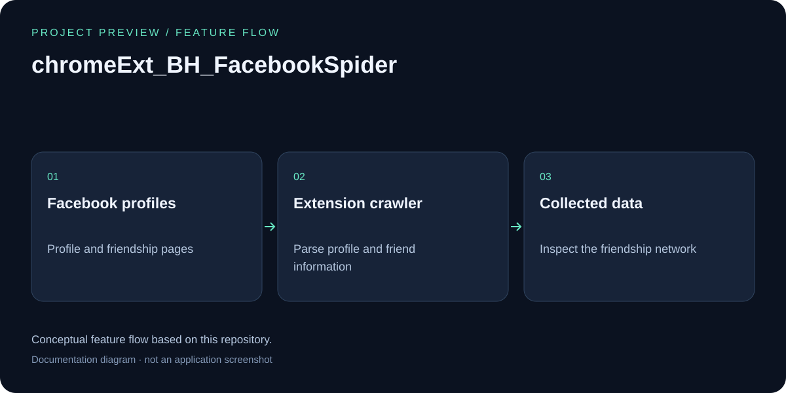

# Facebook Spider Chrome Extension

## Feature overview



Conceptual feature flow based on this repository; this is a documentation diagram, not an application screenshot.

A Chrome extension tool to parse and analyze Facebook friendship networks by automatically crawling user profiles and collecting data about users and their friends.

## Features

- **Automated Profile Scraping**: Automatically visits Facebook user profiles to extract information
- **Friend Network Analysis**: Crawls through friends lists to build a network graph
- **Data Collection**: Extracts user information including:
  - User ID and username
  - Gender and locale
  - Birthday information
  - Work/employment details
- **Local Database Storage**: Uses IndexedDB to store collected data locally
- **Smart Navigation**: Automatically navigates through different Facebook pages (profile, about, friends)
- **Queue Management**: Maintains a queue of users to process to ensure systematic crawling

## Installation

1. Clone or download this repository
2. Open Chrome and navigate to `chrome://extensions/`
3. Enable "Developer mode" in the top right corner
4. Click "Load unpacked" and select the extension directory
5. The extension will appear in your Chrome toolbar

## Usage

1. **Navigate to Facebook**: Go to any Facebook user profile page
2. **Activate the Extension**: Click on the Facebook Spider icon in your Chrome toolbar
3. **Control Panel**: Use the popup control panel with the following options:
   - **Start Spider**: Begin the automated crawling process
   - **Stop Spider**: Halt the crawling process
   - **Show All Data**: Display all collected data from the local database

### How It Works

The extension follows a systematic crawling pattern:

1. **Profile Page**: Extracts work information from the user's profile
2. **About Page**: Collects birthday and other personal details
3. **Graph API**: Fetches additional user data from Facebook's Graph API
4. **Friends Page**: Analyzes the friends list and adds new users to the crawling queue
5. **Queue Processing**: Moves to the next user in the queue and repeats the process

## Technical Details

### File Structure

- `manifest.json` - Extension configuration and permissions
- `background.js` - Background script handling extension lifecycle
- `contentScript.js` - Main crawling logic injected into Facebook pages
- `controlPanel.html/js` - User interface for controlling the extension
- `databaseHelper.js` - IndexedDB operations for data storage
- `actionTable.js` - Message constants for inter-script communication
- `utils.js` & `log.js` - Utility functions and logging

### Database Schema

The extension stores data in IndexedDB with the following structure:
```javascript
{
  id: "Facebook User ID",
  username: "Facebook username",
  gender: "User gender",
  locale: "User locale/language",
  birthday: "User birthday",
  work: "Employment information"
}
```

### Permissions Required

- `tabs` - To interact with browser tabs
- `http://*/*` & `https://*/*` - To access Facebook pages
- Content script injection on `facebook.com` domains

## Important Notes

⚠️ **Legal and Ethical Considerations**:
- This tool is for educational and research purposes only
- Ensure compliance with Facebook's Terms of Service
- Respect user privacy and data protection laws (GDPR, CCPA, etc.)
- Only use on accounts where you have explicit permission
- Be mindful of rate limiting to avoid being blocked by Facebook

⚠️ **Technical Limitations**:
- Facebook frequently changes their page structure, which may break the scraping functionality
- The extension relies on specific CSS selectors that may need updates
- Privacy settings of target users may limit data availability

## Development

### Prerequisites
- Chrome browser with developer mode enabled
- Basic knowledge of JavaScript and Chrome extension development

### Debugging
- Open Chrome DevTools on Facebook pages to see console logs
- Use the extension's background page console for background script debugging
- Check the popup console for control panel issues

## Version History

- **v1.0.0** - Initial release with basic crawling functionality